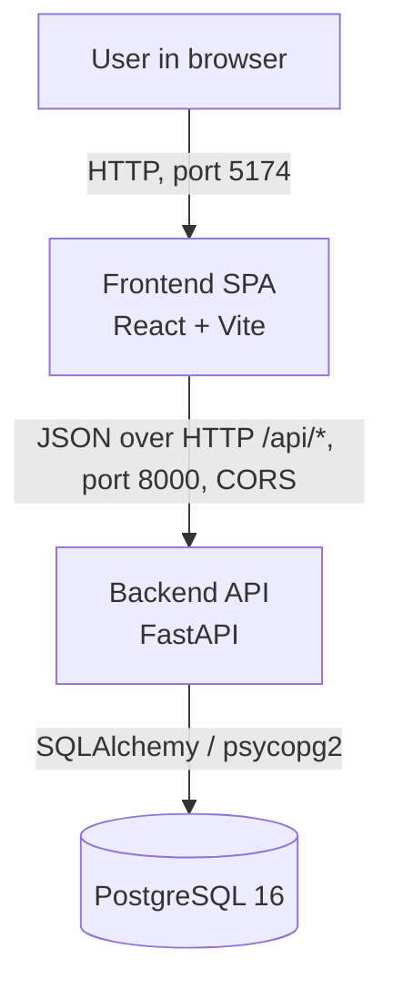

# Architecture — TODO Board

> DRAFT hydrated from code on 2026-11-17. Claims cite files; "inferred" marks single-example patterns.

## System Context

## Containers
Orchestrated by `docker-compose.yml` (three services + one volume `postgres_data`).

| Container | Tech | Notes |
|---|---|---|
| `frontend` | React 19, TypeScript, Vite, Tailwind 4, shadcn/ui (base-ui), dnd-kit | Dev server in container on 5173, published as host **5174**. Reads `VITE_API_URL` (default `http://localhost:8000`). |
| `backend` | Python 3.12, FastAPI 0.115, SQLAlchemy 2.0, pydantic-settings, uvicorn `--reload` | Port **8000**. Env: `DATABASE_URL`, `CORS_ORIGINS`. Source bind-mounted at `/app`. |
| `db` | PostgreSQL 16-alpine | Container 5432, published as host **5435**. Healthcheck gates backend start. |

Backend internals (`backend/app/`): `main.py` (app, CORS, router mount, health) → `routers/tasks.py` (HTTP) → `crud.py` (queries/commits) → `models.py` (ORM) ; `schemas.py` (pydantic I/O); `database.py` (engine, `SessionLocal`, `get_db`); `config.py` (settings).
Frontend internals (`frontend/src/`): `components/board.tsx` (DnD orchestration) → `hooks/use-tasks.ts` (state + optimistic updates + toasts) → `lib/api.ts` (only `fetch` caller) ; `types.ts` (shared types, status labels); `components/ui/` (shadcn primitives).

Data model: single table `tasks` (`id` UUID PK, `title` varchar(200), `description` text null, `status` PG enum `task_status`, `position` float, `created_at`, `updated_at` timestamptz).
Schema is created at startup via `Base.metadata.create_all` in `main.py`; there is no migration tool.

## Boundary Rules
- Layering is one-way: router → `crud` → `models`. Routers handle HTTP concerns (404s, status codes); `crud.py` owns queries and `commit`; routers never touch `db` directly except via `crud` (`routers/tasks.py`). (confirmed, single resource)
- DB sessions come only from the `get_db` FastAPI dependency (`database.py`); don't create `SessionLocal()` in routes. (confirmed)
- API shapes are defined by pydantic schemas (`schemas.py`) and returned via `response_model`; ORM objects are not returned raw. (confirmed)
- All frontend HTTP goes through `lib/api.ts`; components never call `fetch`. Server state lives in `hooks/use-tasks.ts`. (confirmed)
- All REST routes live under `/api/`. (confirmed)
- Task ordering is a float `position` set by the client on move (`TaskMove`); the server does not renumber. (confirmed)
- Browser-to-API access is governed by `CORS_ORIGINS`; the UI's origin must be listed. (confirmed)
- Identity: none today — endpoints are unauthenticated. Any auth work is a new boundary and needs an ADR. (confirmed absent)

## Governing ADRs
- [ADR-0001 — Record architecture decisions](../adr/0001-record-architecture-decisions.md)
<!-- add links as ADRs are written, e.g. [ADR-0002 title](../adr/0002-slug.md) -->
